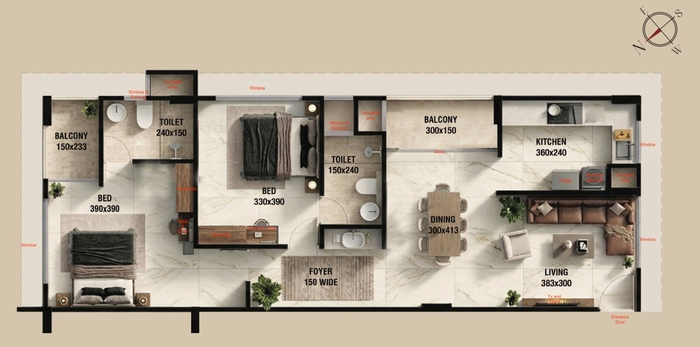
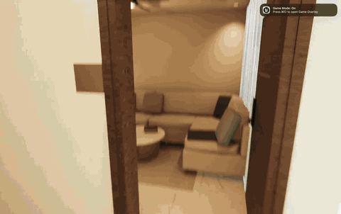
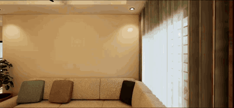

# flat-3d-walkthrough-kit

Claude Code skills that turn an apartment floor plan into a walkable first-person 3D app for macOS and Android
(Blender → Unreal Engine 5.8), in Furnished, Semi-furnished and Without-furniture versions, optionally with the real
surroundings seen from the balconies (geo-referenced from latitude/longitude).

## What it does: input → output

**Input:** a floor plan image (below), plus a few answers Claude asks for (builder or style references, which way the
balconies face, a location pin if you want the real surroundings in the views).

<p align="center"></p>

**Output:** the same flat as a first-person walkthrough app, from the plan's exact dimensions.
Click a preview for the full recording.

| macOS app (Unreal, Lumen lighting, with the balcony view) | Android app (baked lighting, touch controls) |
|---|---|
| [](recordings/mac_walkthrough.mp4) | [](recordings/android_walkthrough.mp4) |

| Skill | Purpose |
|---|---|
| `flat-walkthrough` | Entry point: intake (asks for missing inputs), project scaffold, stage order. Holds the script kit, UE template content and Poly Haven (CC0) library |
| `flat-plan-to-blender` | Plan → exact-dimension Blender shell, checked by overlay |
| `flat-furnishing` | Builder-style furniture and materials; variant definitions |
| `flat-environment` | Terrain, houses, towers and trees around the site |
| `flat-unreal-mac` | Unreal import, walk checks, one Mac app per variant |
| `flat-android` | Baked lighting, one APK per variant, phone testing |

## Install

```bash
cp -R flat-* ~/.claude/skills/
```

Needs Blender, Unreal Engine 5.8, Android Studio and Python with numpy/scipy/Pillow/scikit-image. Start by giving
Claude Code a floor plan and asking for a walkthrough. `flat-walkthrough/example_typeG/` documents the worked example.

## Licences

Poly Haven assets and textures are CC0. `flat-walkthrough/base/ue_content` is derived from Epic Games' First Person
template and is subject to the Unreal Engine EULA. Satellite imagery is used for locating features only and is never shipped.
